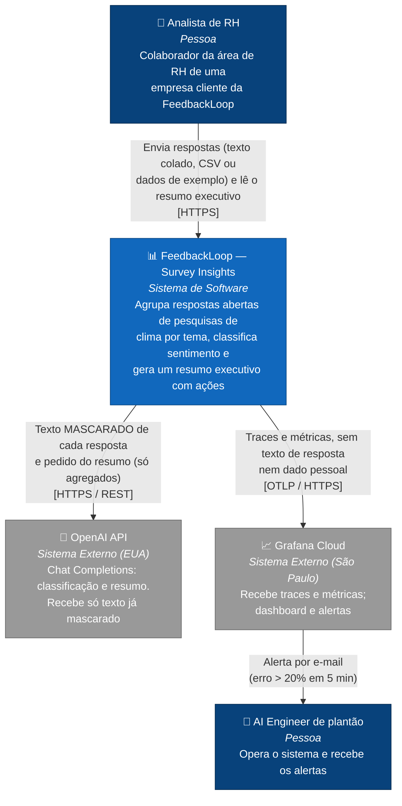

# C4 — Nível 1: Diagrama de Contexto

Mostra o sistema FeedbackLoop na sua fronteira mais ampla: quem usa e com quem ele conversa fora dela. *Atualizado na Etapa 2 (v1.0): entra o Grafana Cloud e a transferência de dados passa a ser descrita com a sanitização.*

## Elementos

| Elemento | Tipo | Descrição |
|---|---|---|
| Analista de RH | Pessoa | Usuário final. Acessa a URL pública pelo navegador; não precisa de conta nem instalação local. |
| AI Engineer de plantão | Pessoa | Recebe os alertas e usa o [runbook](../observabilidade/runbook.md). |
| FeedbackLoop — Survey Insights | Sistema de software (o sistema em construção) | Aplicação web que recebe respostas abertas e devolve um resumo executivo com temas, sentimento e ações recomendadas. |
| OpenAI API | Sistema externo, no exterior | Recebe **o texto já sanitizado** de cada resposta. Operador subcontratado; a transferência internacional está documentada em [transferencia-internacional.md](../lgpd/transferencia-internacional.md). |
| Grafana Cloud | Sistema externo, região São Paulo | Recebe só telemetria: contagens, durações, tokens, custo e rótulos. Não recebe texto de resposta (há testes para isso). |

## O que não está neste diagrama, e por quê

* **O Render** (hospedagem) é onde o sistema roda, não um sistema com o qual ele conversa; ele aparece no diagrama de contêineres como a plataforma de execução. Do ponto de vista de LGPD, o Render processa o texto **original** em memória (a sanitização acontece dentro do app), e isso está registrado no [mapa de dados](../lgpd/mapa-de-dados-pessoais.md).
* Não há sistema de autenticação, banco de dados externo, fila ou billing nesta versão. O sistema é de sessão única; o resultado da análise não é persistido (ver [auditoria](../auditoria-prototipo.md), seção 5).
