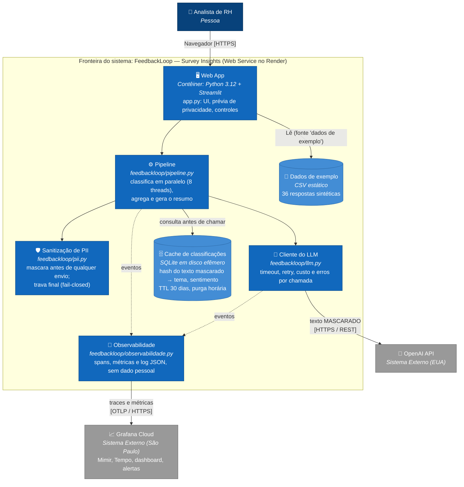

# C4 — Nível 2: Diagrama de Contêineres

Abre o sistema FeedbackLoop (a caixa azul do Nível 1). Continua sendo um monólito de um único processo; a Etapa 2 acrescentou **componentes dentro do processo** e **um armazenamento local** (o cache). *Atualizado na v1.0.*

> Em rigor de C4, Web App, Pipeline, PII, Cliente do LLM e Observabilidade são **componentes** (nível 3) do mesmo contêiner (um processo Python). Estão desenhados aqui, separados, porque é onde as fronteiras de **dados** passam: o que sai do processo e o que é gravado em disco.

## Elementos

| Elemento | Tecnologia | Responsabilidade e limite de dados |
|---|---|---|
| Web App | Python 3.12, Streamlit, `pandas` | Único deployable. Hospedado no Render ([ADR-002](../adr/0002-plataforma-de-deploy.md)). **Recebe o texto original** das respostas e o mantém só em memória, durante a sessão. |
| Sanitização de PII | Regras + léxico + pistas de contexto ([ADR-004](../adr/0004-sanitizacao-de-pii-por-regras.md)) | Troca nomes, e-mails, telefones, CPF etc. por marcadores (`[PESSOA_1]`). A **trava final** impede qualquer chamada se restar PII reconhecível. Recall medido: 100% nas categorias cobertas, 87,5% no total. |
| Pipeline | Python, `ThreadPoolExecutor` | Classificação em paralelo ([ADR-005](../adr/0005-otimizacao-concorrencia-e-cache.md)); o resumo recebe só agregados. |
| Cliente do LLM | SDK OpenAI 1.50 | Cada chamada gera span e métricas (tokens, custo, erro). A chave vem de variável de ambiente, uma por ambiente. |
| Observabilidade | OpenTelemetry SDK ([ADR-003](../adr/0003-observabilidade-opentelemetry-grafana-cloud.md)) | Exporta telemetria; **nunca** texto de resposta, nome ou token. |
| Cache de classificações | SQLite, arquivo local | Guarda `sha256(versão do prompt, modelo, texto mascarado)` → `{tema, sentimento}`. **Não guarda o texto.** TTL de 30 dias (teto 90), purga na subida e a cada hora, botão "Excluir cache agora" ([política de retenção](../lgpd/politica-de-retencao-e-exclusao.md)). O disco do Render gratuito é efêmero: o cache some a cada deploy. |
| Dados de exemplo | CSV versionado em Git | Estático e sintético. Não guarda resultado de ninguém. |

## Fronteiras de dados (o que atravessa cada seta)

| Seta | Conteúdo | Tem dado pessoal? |
|---|---|---|
| Analista → Web App | Texto original das respostas | **Sim** (pode conter nomes de terceiros) |
| Pipeline → OpenAI | Texto **mascarado** + instruções | Residual possível (lacunas medidas) |
| Web App → Grafana | Contagens, durações, tokens, custo, rótulos | Não (testado) |
| Pipeline → Cache | Hash + tema + sentimento | Não guarda texto; tratado como dado derivado |

## Por que continua sendo um monólito

Não existe API separada, banco de dados de aplicação, Redis nem fila. O cache em SQLite é um **arquivo local do mesmo processo**, escolhido para não criar um novo serviço, uma nova conta e uma nova superfície de LGPD (comparação no [ADR-005](../adr/0005-otimizacao-concorrencia-e-cache.md)). Se houver persistência de análises, este diagrama ganha um banco e uma nova ADR, não antes disso.
